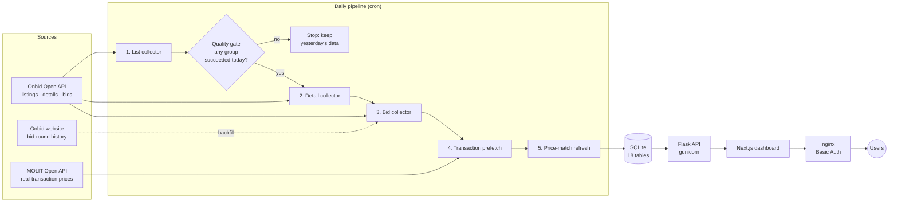
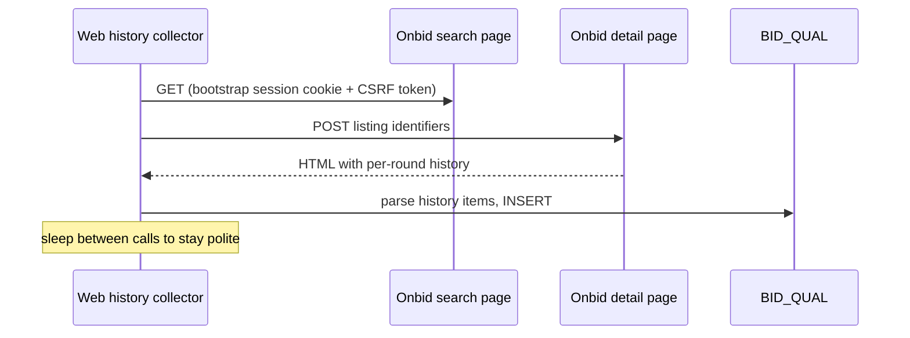
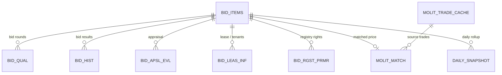

# Onbid Auction Pipeline

A production data pipeline and dashboard for Korean public real-estate auctions (**Onbid**, run by KAMCO). It collects listings from two government Open APIs every day, fills the gaps those APIs leave, matches each listing to nearby real-transaction prices, and serves the result to an internal dashboard.

It replaced a manual workflow: before this, people searched the Onbid website one listing at a time and compared prices by hand.


---

## Architecture



## What makes it interesting

### 1. A quality gate that protects production data
Government APIs fail in quiet ways: an outage can return an empty but "successful" response. After the first stage runs, the orchestrator checks `COLLECTION_LOG` for at least one successful group **today**. If there is none, the pipeline stops, so stale or empty data never flows into the detail and bid stages. Every run is appended to a cron history log.

### 2. Filling a hole in the official API
The Open API only returns bid-round history while a listing has an *active* auction condition. Once a listing moves to private-contract sale, the API answers `NODATA` and that history is lost for good. `onbid_web_history_collector.py` gets it from the public web page instead:



### 3. Tiered matching to real-transaction prices
To judge whether a listing is cheap, it has to be compared with real sales of similar property. The MOLIT API is keyed by a 5-digit district code, so `lawd_code.py` maps **118 province/district name pairs** to legal district codes. Then each listing is matched from the most specific evidence to the least:

| Tier | Rule | Confidence |
|:---:|---|---|
| **0** | Same neighborhood + same lot number (jibun) | Same building, confirmed |
| **1** | Same neighborhood + same building name + area within ±50% | Very high |
| **2** | Same neighborhood + area within ±50% | Medium |
| **3** | Same district + area within ±50% | Low, fallback |

The tier is stored with every match, so the dashboard can show *how* a price was found, not just the price. Lot-number parsing has its own unit tests (`collector/tests/test_jibun.py`), and `scripts/measure_jibun_match.py` measures parse success and Tier 0 hit rate.

### 4. A transparent investment score
Each listing gets a 0–100 score:

```
score = 0.7 × price_score + 0.3 × location_score

price_score = 100 × (1 − (r − r_min) / (r_p95 − r_min)),   r = starting bid / market price
```

A lower starting price relative to the market means a higher score. The ratio is clipped at the 95th percentile so a few outliers can't squash everyone else's score, and the API returns the breakdown (`price` vs `location`) along with the total.

## Data model



All loads are idempotent, so a re-run never duplicates rows. Listings and snapshots use upserts (`ON CONFLICT … DO UPDATE`), and child tables (details, bid rounds, cached trades) are replaced per listing or per district-month with delete-then-insert. `DAILY_SNAPSHOT` materializes daily counts by region and asset type for reporting. `COLLECTION_LOG`, `MOLIT_FETCH_LOG`, and `ALERT_LOG` record what ran and when.

## Dashboard

| Page | What it shows |
|---|---|
| `/` | Filterable listing table: sortable columns, drag-to-reorder headers (saved locally), discount-vs-start-price column |
| `/items/[id]` | Listing detail: bid-round history grouped by auction condition, tenants, registry rights, matched transactions, appraisal PDF download |
| `/analytics` | Score distribution, trends, flow, discount by region (Recharts) |
| `/bookmark` | Saved listings |

The Flask API exposes 15 endpoints (`/api/items`, `/api/items/<id>/market-price`, `/api/analytics/*`, …). `POST /api/items/<id>/refresh` re-pulls a single listing on demand.

## Run it

```bash
cp .env.example .env          # add your data.go.kr service key
docker compose up -d --build  # api + web + nginx

# collection is a manual-profile service, triggered by host cron
docker compose --profile manual run --rm onbid_collector
```

Cron example (daily at 06:00):

```
0 6 * * * cd /path/to/onbid-auction-pipeline && docker compose --profile manual run --rm onbid_collector
```

## Project layout

```
collector/   # 5 pipeline stages + web-history backfill + district-code map
processor/   # ratio, status, query helpers
db/          # schema per domain (items, detail, bid, molit)
api/         # Flask app
frontend/    # Next.js 16 + Tailwind 4 + Recharts
nginx/       # reverse proxy with Basic Auth
scripts/     # match-coverage measurement and diagnostics
tests/       # live API smoke tests (need ONBID_API_KEY)
```

## Notes

- Built at work as the company's first data pipeline and shared here with permission. The git history was not carried over.
- The web-history collector uses an unofficial path. If Onbid changes its page markup, parsing will break. It waits between calls on purpose.
